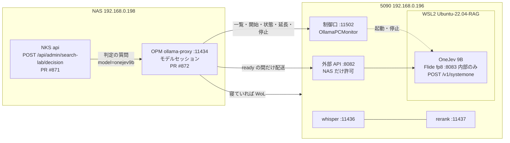
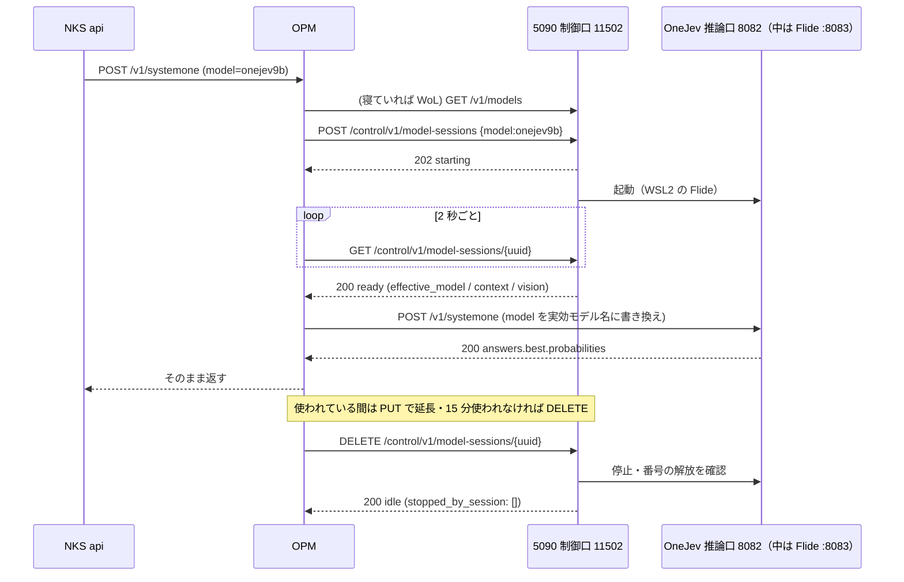

# OneJev 9B を 5090 で動かす — 接続仕様と機能仕様（Rev2）

結論: 5090 に判定専用モデル OneJev 9B を「NAS から呼ばれたときだけ動く」セッションとして置く。制御は今の Strata と同じ制御口（11502）、推論は**外部 API の 8082** の `/v1/systemone`（Strata・SGLang と同じ口。中でモデルごとに振り分ける）。
Rev2 では、5090 側で決めた値（7 章）と、実装・実機で確かめた結果（9 章）を反映した。**5090 側の実装は済み。残りは NAS からの疎通試験（6 章）。**
条件: whisper・rerank は止めない。一度に動くセッションは 1 つ。推論口は NAS（192.168.0.198）からだけ受ける。

作成: 2026-10-30 23:24 JST（調停役）／Rev2: 2026-10-31（5090 側）
状態: **5090 側は実装済み・単体の実機確認済み**。モニタ経由の通しと NAS からの疎通は未実施。ファイアウォールは既存の 8082 の規則で足りる。NAS 側は PR #871・#872 が CI 緑でマージ待ち
元にしたもの: `contracts/opm-strata-model-session.md`（Strata の契約・付録 A〜C・G・H）、OneJev の README とモデルの一覧

## Rev1 からの変更点

| # | 項目 | Rev1 | Rev2 |
|---|---|---|---|
| 1 | 推論基盤 | 5090 側で決める | **Flide（元の重み）を fp8 で動かす**。WSL2 `Ubuntu-22.04-RAG` 上 |
| 2 | `inference_port` | 8083（仮） | **8082（確定）**。外部 API の 8082 に統一。Flide 自身は WSL2 内の 8083 で待ち受けるが、外には出さない |
| 3 | `inference_model` | 未定 | **`onejev1.6-9b`** |
| 4 | `context_window` | 未定 | **16384**（`flide serve --max-request-tokens 16384`） |
| 5 | GPU 使用量 | 未定 | **18.3 GB**（推論中・fp8）。bf16 は 25.4 GB で不採用 |
| 6 | 推論口の作り | 専用の口を足す | 専用の口は作らない。既存の 8082 ゲートウェイ（`inference-gateway.js`）に OneJev の行き先（WSL2 の Flide :8083）を足し、`/v1/systemone` を中継する。`model` 欄の書き換えもここで行う。NAS だけに絞るファイアウォールは 8082 の既存規則のまま |
| 7 | 一覧の `api`・`inference_port` | OneJev の項目に足す | **全項目に出す**。Strata・SGLang は `openai`・8082 を明示（NAS は欄が無くても従来どおり扱う） |
| 8 | 解放の応答 | `stopped_by_session: []` | `{"state":"idle","stopped_by_session":[],"restored":[]}`（OneJev は whisper・rerank を止めないので常に空） |
| 9 | ダッシュボード | 記載なし | 「大型 LLM モデル起動」パネルに OneJev を追加（手動の起動・停止）。条件は既存と同じ |

## 1. 目的

文書の木を上から一段ずつ「どの枝が答えに近いか」を判定させて探す方式（DecisionRAG）を試す。判定役が OneJev 9B。
最初の対象は記録の文書（NAS の `/nas/knowledge-base/`）で、今の検索（意味の近さ）と同じ質問で比べる。

## 2. 全体の形





## 3. 機能仕様（5090 で動かすモデル）

### 3.1 モデル

| 項目 | 中身 |
|---|---|
| モデル | `OmniJev/OneJev1.6-9B`（Hugging Face）。Apache 2.0。元は Qwen3.5-9B |
| 置き場所 | WSL2 の `/root/models/OneJev1.6-9B`（18 GB） |
| 動かし方 | **Flide**（`flide serve`）、`--quantize fp8`。Python 3.12 の venv `/root/venvs/flide`（torch 2.14.1） |
| 入力 | 文字だけ（画像は使わない・`vision=false`） |
| 1 回に扱う長さ | `context_window` = **16384**。NAS は 1 回に最大 40 候補 × 約 300 文字＋題名（日本語で数千〜1 万トークン程度の見込み）。上限ぎりぎりの入力での挙動は未検証 |

- 起動コマンド（`scripts/start-onejev-flide.sh`）
  `flide serve --model /root/models/OneJev1.6-9B --name onejev1.6-9b --quantize fp8 --max-request-tokens 16384 --host 0.0.0.0 --port 8083`
- fp8 を選んだ理由: bf16 と同じ順位・ほぼ同じ確率で、VRAM が 7 GB 少なく、起動も 90 秒以内に収まるため（9.2 の比較を参照）
- GGUF（llama.cpp）は採らない。NAS から見えるのは 4 章の口だけなので、基盤を変えても NAS 側の変更は要らない

### 3.2 必ず持つ働き

| 働き | 要否 | 使い道 |
|---|---|---|
| `choice`（候補から選ぶ・候補ごとの確率） | **必須** | DecisionRAG の各段の判定（NAS は今これだけを使う）。**実機で確認済み** |
| `noul`（はい／いいえの確率） | あれば使う | 「この節は答えを含むか」の確認（次の段階）。未確認 |
| `score`（段階の点数） | あれば使う | 未定。未確認 |
| 画像（`media`） | 使わない | — |

### 3.3 速さ・同居の目安

- **寝ている 5090 を起こしてから ready まで 90 秒以内**が望ましい（OPM が要求を保持して待つ上限。超えると最初の 1 回だけ呼んだ側に 503 が返り、起動は続く）。PC 側の起動待ちの上限は 180 秒（OneJev は 180 秒＝2 秒 × 90 回）
  - 実測: 起動操作から判定が返るまで **56 秒**（WSL2 が既に動いている状態）。WSL2 の起動と WoL の時間は含まない
- 1 回の判定（40 候補）は数秒以内が目安。実測 **約 0.18 秒**（fp8）
- 要求は 1 本ずつ処理でよい（OPM が順番に並べて送る）
- **whisper・rerank と同時に載ったまま動くこと**。OneJev は推論中 18.3 GB。開始前に空き VRAM が 20000 MiB 以上あることを確かめ、足りなければ失敗にする（`gpu_busy`）
  - whisper・rerank が両方動いている状態での同居は**測定済み**（9.1）。両方で 1.5 GB、空き 30.6 GB なので、20000 MiB の条件は満たす
- 5090 の Ollama（11434）に別の大型モデルが載っているときは、今の Strata と同じく `409 gpu_busy` で断る

### 3.4 日本語

- 質問も候補の説明も日本語で届く。**日本語で選べること**を受け入れの条件にする（6 章の試験 ③）
- 5090 側の実機では、日本語の 3 候補で正解が最大確率になった（9.2 参照）。ただし「5090 が寝ない理由は？」のように候補の説明が短いと確率の差は小さい（0.53 対 0.20・0.28）

## 4. 接続仕様（5090 側の口）

### 4.1 制御口（今の 11502 をそのまま使う）

| Method / path | OneJev での中身 |
|---|---|
| `GET /v1/models` | 項目を 1 つ足す（下の形）。**停止中でも返す** |
| `GET /control/v1/model-sessions/availability` | 今と同じ（その瞬間の事前判定。予約ではない） |
| `POST /control/v1/model-sessions` | `{"model":"onejev9b","ttl_seconds":1800,"request_id":"…"}` → `202 {"session_id":"<uuid>","state":"starting",…}`。同じ `request_id` の再送は同じセッションを返す |
| `GET /control/v1/model-sessions/{uuid}` | 下の「ready の形」 |
| `PUT /control/v1/model-sessions/{uuid}` | `{"ttl_seconds":1800}` で延長 |
| `DELETE /control/v1/model-sessions/{uuid}` | 止めてから `200 {"state":"idle","stopped_by_session":[],"restored":[]}`。再送も同じ本文 |

一覧の項目（実装済み）:
```json
{"id":"onejev9b","name":"OneJev 9B","inference_model":"onejev1.6-9b","context_window":16384,
 "vision":false,"api":"systemone","inference_port":8082,"session_state":"idle","ready":false}
```
- `api`・`inference_port` は**全項目に付く**。Strata・SGLang の項目は `"api":"openai"`。`inference_port` は**全モデル 8082**（OneJev だけ `"api":"systemone"`）。無い項目は OPM が従来どおり Strata 扱いにするので、NAS 側の変更は要らない
- `context_window` と ready の `context.max_positions` は同じ値（16384）
- 一覧は 11502 と 8082 のどちらでも同じ内容を返す

ready の形:
```json
{"session_id":"<uuid>","state":"ready","ready":true,"model":"onejev9b",
 "effective_model":"onejev1.6-9b","context":{"max_positions":16384},
 "vision":{"enabled":false},"expires_at":"2026-…+09:00","error":null}
```
- **OPM はこの 3 つ（`effective_model`・`context.max_positions`・`vision.enabled`）が一覧の項目と一致しないと配送しない**（一致しなければ後始末して止める）
- `ready:true` は、OneJev が実際に判定を 1 回返せる状態になってから立てる（TCP や `/health` だけで立てない）。**実装**: 起動後に 2 択の日本語の判定を 1 回投げ、`probabilities` が 0〜1 の数で返ったら立てる
- 状態の移り方: `starting → ready → stopping → idle`。失敗は `failed → stopping → idle`（起動待ち 180 秒を超えたら `ready_timeout`）
- セッション id は UUID（36 文字）。PC が再起動してもセッションを覚えている。**ただし再起動後は、前のセッションを照合せず、動いていた OneJev を止めて idle に戻す**（Strata と同じ。NAS は新しいセッションを作り直す）
- TTL が切れたら PC 側でも止める
- 止めるときは、OneJev のプロセスが消えて推論口の番号が解放されたことを確かめてから `idle` にする（20 秒待っても閉じなければ失敗）
- **whisper・rerank は止めない**ので `stopped_by_session` は空、`restored` も空。開始・延長で補助サービスの停止要求（作業保留）も出さない

### 4.2 断り方（今と同じ符丁。OPM は HTTP 番号ではなく `code` で判断する）

本文は `{"code":"…","message":"…","retry_after_s":<秒 か null>}`

| 場面 | 応答 |
|---|---|
| 別の大型モデルが載っている | `409 gpu_busy` |
| 空き VRAM が足りない（20000 MiB 未満） | 起動の途中で失敗。開始そのものは 202 で受け付ける。失敗の形は下の「非同期の失敗」を参照 |
| 人の作業宣言がある | `409 human_work_hold` |
| **Strata など別のセッションが有効**（一度に 1 つ） | `409 session_conflict`（`active_session_id` つき） |
| NKS の電源方針が読めない・許さない | `503 policy_blocked` |
| 制御口の準備中 | `503 control_unavailable` |
| 起動・停止の失敗 | `500 start_failed` / `500 stop_failed` |
| 知らないモデル・本文の誤り | `400 unknown_model` / `400 bad_request` |
| UUID の形で知らない id | `404 session_not_found` |

**非同期の失敗（起動の途中での失敗）の形**: `POST` の後の `GET /control/v1/model-sessions/{uuid}` が `state:"failed"` を返し、理由は次の 2 欄に入る（Strata と同じ。5090 側の仕様書 `docs/opm-strata-model-session-spec.md` の記述どおり）。

```json
{"session_id":"<uuid>","state":"failed","ready":false,"model":"onejev9b",
 "error":"GPU memory is not sufficiently free for OneJev 9B","error_code":"gpu_busy", …}
```

- `error` は**文字列**（メッセージ）、符丁は**別の欄 `error_code`**（`gpu_busy`・`start_failed`・`ready_timeout`）
- `"error":{"code":…,"message":…}` というオブジェクトの形では**返していない**。NAS が後者だけを読む作りなら、理由が「起動の失敗」としか出ない。`error_code` を読む形に合わせてもらうか、5090 側を変えるかを調停役が決める（**要確認**）

### 4.3 推論口（OneJev）

- `POST http://192.168.0.196:8082/v1/systemone`。セッションが ready の間だけ待ち受ける（ready でない間は 8082 が `503 model_not_ready`）
- 8082 のゲートウェイが、有効なセッションのモデルに応じて Flide（WSL2 内 :8083、Windows の localhost 経由）へ中継する。Flide の 8083 は外に出さないので、`portproxy` の追加は要らない
- ファイアウォールは NAS（192.168.0.198）だけ。既存の `Strata API 8082 (NAS LAN)` の規則がそのまま効く（4.4 参照）
- 有効なモデルと違う `model` が付いた要求は `409 model_mismatch`
- 本文に `"model"` 欄が付いてくる（OPM が実効モデル名に書き換えて送る）。**あっても断らない**（実機で `model` 付きの要求が通ることを確認済み）

NAS（PR #871）が OPM に送る形。**NAS の窓口は `model` に `onejev9b` を入れる。OPM がそれを実効モデル名 `onejev1.6-9b` に書き換えて 5090 へ渡す**ので、5090 の推論口に届くときは下の例のとおり `onejev1.6-9b` になる:
```json
{"model":"onejev1.6-9b",
 "state":{"question":"5090 が寝ない理由は？"},
 "questions":{"best":{"type":"choice",
   "instructions":"質問の答えに最も近い文書の枝を選ぶ。",
   "criteria":{"0":"coordination-lab — …","1":"nas-knowledge-stack — …"}}}}
```
返してほしい形（200）。実機の応答は下の形に `type`・`choice`・`confidence`・`usage`・`onejev` の欄が加わる。NAS は `answers.best.probabilities` だけ読めばよい:
```json
{"answers":{"best":{"probabilities":{"0":0.82,"1":0.18}}}}
```
- `probabilities` は `criteria` の鍵ごとに 0〜1 の数（合計はおよそ 1）。鍵が欠けた候補は NAS が 0 として扱う
- 0〜1 の外の数・数でない値が来ると、NAS はその検索を失敗として返す
- 失敗は 4xx/5xx と `{"code":…,"message":…}`。NAS は別のモデルへ落とさず、そのまま理由を出す

### 4.4 5090 側の設定作業（管理者権限）

| 作業 | コマンド | 状態 |
|---|---|---|
| ポート転送 | 不要（8083 は外に出さない） | — |
| ファイアウォール | 8082 は設定済み（`Strata API 8082 (NAS LAN)`、`Strata API 8082 (Tailscale only)` が有効なことを確認）。追加の作業なし | **済み** |

## 5. NAS 側の対応（済み・マージ待ち）

| PR | 中身 |
|---|---|
| #872（ollama-proxy） | 一覧の `api`・`inference_port` を読み、`api="systemone"` の項目は `POST /v1/systemone` だけを PC の `inference_port` へ配送する。起こす・要求で起動・90 秒保持・15 分で停止・延長は Strata と同じ道 |
| #871（api） | `POST /api/admin/search-lab/decision`（`{q, path_prefix?, beam?, top?}`）。記録の文書を「フォルダ → ファイル → `##` の節」の木にし、各段で `choice` を呼んで上位 2 本を残して降りる |

- **`onejev9b` は、調停役が 6 章の一巡を通すまで「確認済み」に入れない。**それまでは NKS の口から `onejev9b` で呼んでも届かない（6 章の後に 1 行の PR で足す）

## 6. 受け入れの試験（5090 側ができたら調停役が行う）

1. NAS から `GET :11502/v1/models` に `onejev9b` が上の形で出る（停止中でも）
2. OPM から開始 → ready（3 つの値が一致）→ 起こしてからの秒数を記録
3. 実効モデル名（`onejev1.6-9b`）で `POST /v1/systemone` を 1 往復。日本語の質問と候補 3 つ（答えが明らかなもの）で、正しい候補の確率がいちばん高い
4. 40 候補で 1 回呼んだときの秒数を記録
5. ready の間も whisper（11436）・rerank（11437）が 200 を返す
6. Strata が動いている間に OneJev を開始 → `409 session_conflict`
7. 使わずに置く → 15 分で止まり、推論口の番号が閉じる
8. 通ったら `onejev9b` を確認済みに足す PR → 配布 → NKS の口で同じ質問を今の検索と比べる

5090 側の事前確認（9 章）は、試験の 3・4 の一部（5090 内からの確認）を済ませたもの。NAS を経由した確認は含まない。

## 7. 5090 側で決めた値

| 項目 | 決めた値 |
|---|---|
| `inference_port` | 8082（Flide の内部ポートは 8083） |
| 実効モデル名（`inference_model`） | `onejev1.6-9b` |
| `context_window` | 16384 |
| 基盤 | Flide（元の重み）、fp8 |
| GPU の使用量 | 推論中 18.3 GB（OneJev のみ）。whisper・rerank が動いている状態では合計 19.7 GB（空き 12.5 GB） |

## 8. ダッシュボード（11501）

- 「大型 LLM モデル起動」パネルに `OneJev 9B (判定専用)`（`:8082`）を追加した。手動で起動・停止できる
- 操作できる条件は既存のモデルと同じ。**作業宣言中で、かつ whisper・rerank の GPU 解放を確認できたときだけ**。例外は設けない
- 「起動中」の表示は、判定を 1 回返せる状態のときだけ
- OneJev が動いている間は、NAS からのセッション開始が `gpu_busy` で断られる。他のモデルを選ぶと OneJev は止まる
- OPM のセッションが有効な間、この手動操作は 409 で断る（既存と同じ）

## 9. 実機での確認結果（5090 内・NAS を経由しない）

### 9.1 確認できたこと

| 項目 | 結果 |
|---|---|
| 起動スクリプトで起動し、判定が返るまで | 56 秒 |
| 日本語の 3 候補（冷蔵庫の質問） | 正解の確率 0.9989（fp8） |
| 40 候補で正解を埋め込んだ判定（3 回） | 毎回 正解を選び、確率 0.997。0.17〜0.18 秒 |
| 停止スクリプトで止める | 内部ポート 8083 が閉じ、VRAM が 111 MiB まで戻る（57 秒時点） |
| whisper・rerank との同居 | 両方動かした状態（使用 1.5 GB・空き 30.6 GB）で OneJev を起動し、判定が返った。このときの合計使用量は 19.7 GB（空き 12.5 GB）。whisper（11436）・rerank（11437）は `/health` が 200 のまま（試験 5 の 5090 内での確認）。測定後、whisper は元の停止状態（Ready）に戻した |
| 自動試験 | 16 件通過。OneJev 用: 補助サービスを止めない・解放の本文が空・別セッションで `session_conflict`・VRAM 不足で失敗・一覧の欄・8082 ゲートウェイが `/v1/systemone` を中継して `model` を書き換える |

### 9.2 bf16 と fp8 の比較

| | bf16 | fp8（採用） |
|---|---|---|
| 推論中の VRAM | 25.4 GB | 18.3 GB |
| 40 候補の判定 | 約 0.3 秒 | 約 0.18 秒 |
| 40 候補の正解の確率 | 0.997 | 0.997 |
| 日本語 3 候補（冷蔵庫）の正解の確率 | 0.9989 | 0.9989（ほぼ同じ） |
| 「5090 が寝ない理由」3 候補の確率（正解は 1） | 0.20 / 0.53 / 0.28 | 0.18 / 0.56 / 0.26 |
| 起動 | 初回は計測が乱れた（PC のスリープの疑い） | 56 秒 |

### 9.3 まだ確認していないこと

- モニタ（11502）経由で、開始 → ready → 延長 → 解放までの通し（モニタの再起動が必要）
- 8082 ゲートウェイ経由の実機での中継（中継の動きは自動試験で確認済み。Flide への実接続は 8083 直接で確認済み）と、NAS からの疎通
- 失敗理由の形（4.2）を NAS がどう読むか
- `--max-request-tokens 16384` の上限ぎりぎりの入力、`noul`・`score`
- 寝ている 5090 を WoL で起こした場合の、ready までの合計秒数
- ダッシュボードの画面表示と、画面からの起動・停止

## 10. 出典・関連

- OneJev の README: https://github.com/OmniJev/OneJev （`/v1/systemone` の例・Flide / llama.cpp / Docker の動かし方・H200 での速さ）
- モデルの一覧: https://huggingface.co/collections/OmniJev/onejev16 （`OmniJev/OneJev1.6-9B`・`mradermacher/OneJev1.6-9B-GGUF`）
- 今の制御口の実機の振る舞い: `contracts/opm-strata-model-session.md` 付録 A〜C・G
- 実装: `model-sessions.js`、`sglang-services.js`、`scripts/start-onejev-flide.sh`・`stop-onejev-flide.sh`・`Start-OneJev-Flide.ps1`・`Stop-OneJev-Flide.ps1`
