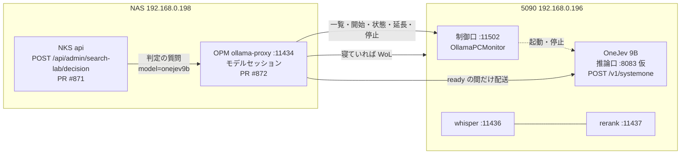
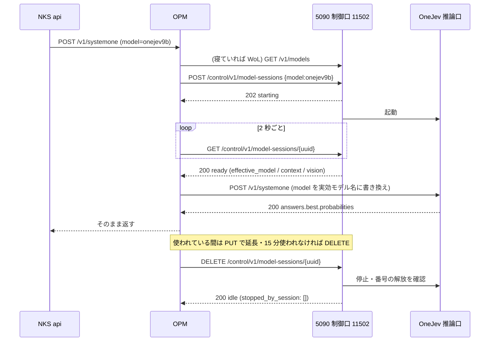

# OneJev 9B を 5090 で動かす — 接続仕様と機能仕様

結論: 5090 に判定専用モデル OneJev 9B を「NAS から呼ばれたときだけ動く」セッションとして置く。制御は今の Strata と同じ制御口（11502）、推論は別の番号の `/v1/systemone`。
5090 側（オーナー）がやること: この文書の「3. 機能仕様」のとおりに OneJev を動かせるようにし、「4. 接続仕様」のとおりに制御口と推論口を足す。
条件: whisper・rerank は止めない。一度に動くセッションは 1 つ。推論口は NAS（192.168.0.198）からだけ受ける。

作成: 2026-10-30 23:24 JST（調停役）／状態: 提案（PC 側は未実装・NAS 側は PR #871・#872 が CI 緑でマージ待ち）
元にしたもの: `contracts/opm-strata-model-session.md`（Strata の契約・付録 A〜C・G・H）、OneJev の README とモデルの一覧（2026-10-30 に読んだもの）

## 1. 目的

文書の木を上から一段ずつ「どの枝が答えに近いか」を判定させて探す方式（DecisionRAG）を試す。判定役が OneJev 9B。
最初の対象は記録の文書（NAS の `/nas/knowledge-base/`）で、今の検索（意味の近さ）と同じ質問で比べる。

## 2. 全体の形





## 3. 機能仕様（5090 で動かすモデル）

### 3.1 モデル

| 項目 | 中身 |
|---|---|
| モデル | `OmniJev/OneJev1.6-9B`（Hugging Face）。Apache 2.0。元は Qwen3.5-9B |
| 縮めた版（代わりに使ってよい） | `mradermacher/OneJev1.6-9B-GGUF`（llama.cpp 用）。どの量子化にするかは 5090 側で決める |
| 入力 | 文字だけ（画像は使わない・`vision=false`） |
| 1 回に扱う長さ | 5090 側で決めて `context_window` に書く。NAS は 1 回に最大 40 候補 × 約 300 文字＋題名を送る（日本語で数千〜1 万トークン程度の見込み） |

- 公式の動かし方は 2 通り（README より）
  - Flide（NVIDIA・そのままの重み）: `flide serve --model OmniJev/OneJev1.6-9B --port <番号>`
  - llama.cpp（GGUF）: `qev serve --gguf mradermacher/OneJev1.6-9B-GGUF:<量子化> --port <番号>`
  - Docker（`docker/start.sh`）は Windows では `torch` と `cpu` だけ
- **どちらで動かすかは 5090 側で決めてよい。**NAS から見えるのは 4 章の口だけ

### 3.2 必ず持つ働き

| 働き | 要否 | 使い道 |
|---|---|---|
| `choice`（候補から選ぶ・候補ごとの確率） | **必須** | DecisionRAG の各段の判定（NAS は今これだけを使う） |
| `noul`（はい／いいえの確率） | あれば使う | 「この節は答えを含むか」の確認（次の段階） |
| `score`（段階の点数） | あれば使う | 未定 |
| 画像（`media`） | 使わない | — |

### 3.3 速さ・同居の目安

- **寝ている 5090 を起こしてから ready まで 90 秒以内**が望ましい（OPM が要求を保持して待つ上限。超えると最初の 1 回だけ呼んだ側に 503 が返り、起動は続く）。PC 側の起動待ちの上限は 180 秒
- 1 回の判定（40 候補）は数秒以内が目安（DecisionRAG は 1 回の検索で 5〜10 回ほど判定を呼ぶ）
- 要求は 1 本ずつ処理でよい（OPM が順番に並べて送る）
- **whisper・rerank と同時に載ったまま動くこと**。GPU の量（32GB）を超えないよう、モデルと長さの設定を決める
- 5090 の Ollama（11434）に別の大型モデルが載っているときは、今の Strata と同じく `409 gpu_busy` で断る

### 3.4 日本語

- 質問も候補の説明も日本語で届く。**日本語で選べること**を受け入れの条件にする（6 章の試験 ③）

## 4. 接続仕様（5090 側の口）

### 4.1 制御口（今の 11502 をそのまま使う）

| Method / path | OneJev での中身 |
|---|---|
| `GET /v1/models` | 項目を 1 つ足す（下の形）。**停止中でも返す** |
| `GET /control/v1/model-sessions/availability` | 今と同じ（その瞬間の事前判定。予約ではない） |
| `POST /control/v1/model-sessions` | `{"model":"onejev9b","ttl_seconds":1800,"request_id":"…"}` → `202 {"session_id":"<uuid>","state":"starting",…}`。同じ `request_id` の再送は同じセッションを返す |
| `GET /control/v1/model-sessions/{uuid}` | 下の「ready の形」 |
| `PUT /control/v1/model-sessions/{uuid}` | `{"ttl_seconds":1800}` で延長 |
| `DELETE /control/v1/model-sessions/{uuid}` | 止めてから `200 {"state":"idle","stopped_by_session":[],"restored":[]}`。再送も同じ本文 |

一覧の項目:
```json
{"id":"onejev9b","name":"OneJev 9B","inference_model":"<実効モデル名>","context_window":<整数>,
 "vision":false,"api":"systemone","inference_port":8083,"session_state":"idle"}
```
- `api`・`inference_port` は今回足す欄。**無い項目は OPM が従来どおり Strata 扱い（`openai`・8082）にする**ので、Strata の項目は変えなくてよい
- `context_window` と ready の `context.max_positions` は同じ値

ready の形:
```json
{"session_id":"<uuid>","state":"ready","ready":true,"model":"onejev9b",
 "effective_model":"<inference_model と同じ綴り>","context":{"max_positions":<context_window と同じ>},
 "vision":{"enabled":false},"expires_at":"2026-…+09:00","error":null}
```
- **OPM はこの 3 つ（`effective_model`・`context.max_positions`・`vision.enabled`）が一覧の項目と一致しないと配送しない**（一致しなければ後始末して止める）
- `ready:true` は、OneJev が実際に判定を 1 回返せる状態になってから立てる（TCP や `/health` だけで立てない）
- 状態の移り方: `starting → ready → stopping → idle`。失敗は `failed → stopping → idle`（起動待ち 180 秒を超えたら `ready_timeout`）
- セッション id は UUID（36 文字）。PC が再起動してもセッションを覚えていて照合できる
- TTL が切れたら PC 側でも止める
- 止めるときは、OneJev のプロセスが消えて推論口の番号が解放されたことを確かめてから `idle` にする
- **whisper・rerank は止めない**ので `stopped_by_session` は空

### 4.2 断り方（今と同じ符丁。OPM は HTTP 番号ではなく `code` で判断する）

本文は `{"code":"…","message":"…","retry_after_s":<秒 か null>}`

| 場面 | 応答 |
|---|---|
| 別の大型モデルが載っている | `409 gpu_busy` |
| 人の作業宣言がある | `409 human_work_hold` |
| **Strata など別のセッションが有効**（一度に 1 つ） | `409 session_conflict`（`active_session_id` つき） |
| NKS の電源方針が読めない・許さない | `503 policy_blocked` |
| 制御口の準備中 | `503 control_unavailable` |
| 起動・停止の失敗 | `500 start_failed` / `500 stop_failed` |
| 知らないモデル・本文の誤り | `400 unknown_model` / `400 bad_request` |
| UUID の形で知らない id | `404 session_not_found` |

### 4.3 推論口（OneJev）

- `POST http://192.168.0.196:<inference_port>/v1/systemone`。セッションが ready の間だけ待ち受ける
- ファイアウォールは NAS（192.168.0.198）だけ（Strata の 8082 と同じ）
- 本文に `"model"` 欄が付いてくる（OPM が実効モデル名に書き換えて送る）。**あっても断らない**（無視してよい）

NAS（PR #871）が送る形:
```json
{"model":"<実効モデル名>",
 "state":{"question":"5090 が寝ない理由は？"},
 "questions":{"best":{"type":"choice",
   "instructions":"質問の答えに最も近い文書の枝を選ぶ。",
   "criteria":{"0":"coordination-lab — …","1":"nas-knowledge-stack — …"}}}}
```
返してほしい形（200）:
```json
{"answers":{"best":{"probabilities":{"0":0.82,"1":0.18}}}}
```
- `probabilities` は `criteria` の鍵ごとに 0〜1 の数（合計はおよそ 1）。鍵が欠けた候補は NAS が 0 として扱う
- 0〜1 の外の数・数でない値が来ると、NAS はその検索を失敗として返す
- 失敗は 4xx/5xx と `{"code":…,"message":…}`。NAS は別のモデルへ落とさず、そのまま理由を出す

## 5. NAS 側の対応（済み・マージ待ち）

| PR | 中身 |
|---|---|
| #872（ollama-proxy） | 一覧の `api`・`inference_port` を読み、`api="systemone"` の項目は `POST /v1/systemone` だけを PC の `inference_port` へ配送する。起こす・要求で起動・90 秒保持・15 分で停止・延長は Strata と同じ道 |
| #871（api） | `POST /api/admin/search-lab/decision`（`{q, path_prefix?, beam?, top?}`）。記録の文書を「フォルダ → ファイル → `##` の節」の木にし、各段で `choice` を呼んで上位 2 本を残して降りる |

- **`onejev9b` は、調停役が 6 章の一巡を通すまで「確認済み」に入れない。**それまでは NKS の口から `onejev9b` で呼んでも届かない（6 章の後に 1 行の PR で足す）

## 6. 受け入れの試験（5090 側ができたら調停役が行う）

1. NAS から `GET :11502/v1/models` に `onejev9b` が上の形で出る（停止中でも）
2. OPM から開始 → ready（3 つの値が一致）→ 起こしてからの秒数を記録
3. 実効モデル名で `POST /v1/systemone` を 1 往復。日本語の質問と候補 3 つ（答えが明らかなもの）で、正しい候補の確率がいちばん高い
4. 40 候補で 1 回呼んだときの秒数を記録
5. ready の間も whisper（11436）・rerank（11437）が 200 を返す
6. Strata が動いている間に OneJev を開始 → `409 session_conflict`
7. 使わずに置く → 15 分で止まり、推論口の番号が閉じる
8. 通ったら `onejev9b` を確認済みに足す PR → 配布 → NKS の口で同じ質問を今の検索と比べる

## 7. 5090 側で決めて知らせてほしいこと

- `inference_port` の番号（提案 8083）
- 実効モデル名（`inference_model`）
- `context_window` の値
- Flide（そのままの重み）か llama.cpp（縮めた版・量子化の種類）か
- 載せたときの GPU の使用量（whisper・rerank と合わせて）

## 8. 出典

- OneJev の README: https://github.com/OmniJev/OneJev （`/v1/systemone` の例・Flide / llama.cpp / Docker の動かし方・H200 での速さ）
- モデルの一覧: https://huggingface.co/collections/OmniJev/onejev16 （`OmniJev/OneJev1.6-9B`・`mradermacher/OneJev1.6-9B-GGUF`）
- 今の制御口の実機の振る舞い: `contracts/opm-strata-model-session.md` 付録 A〜C・G
