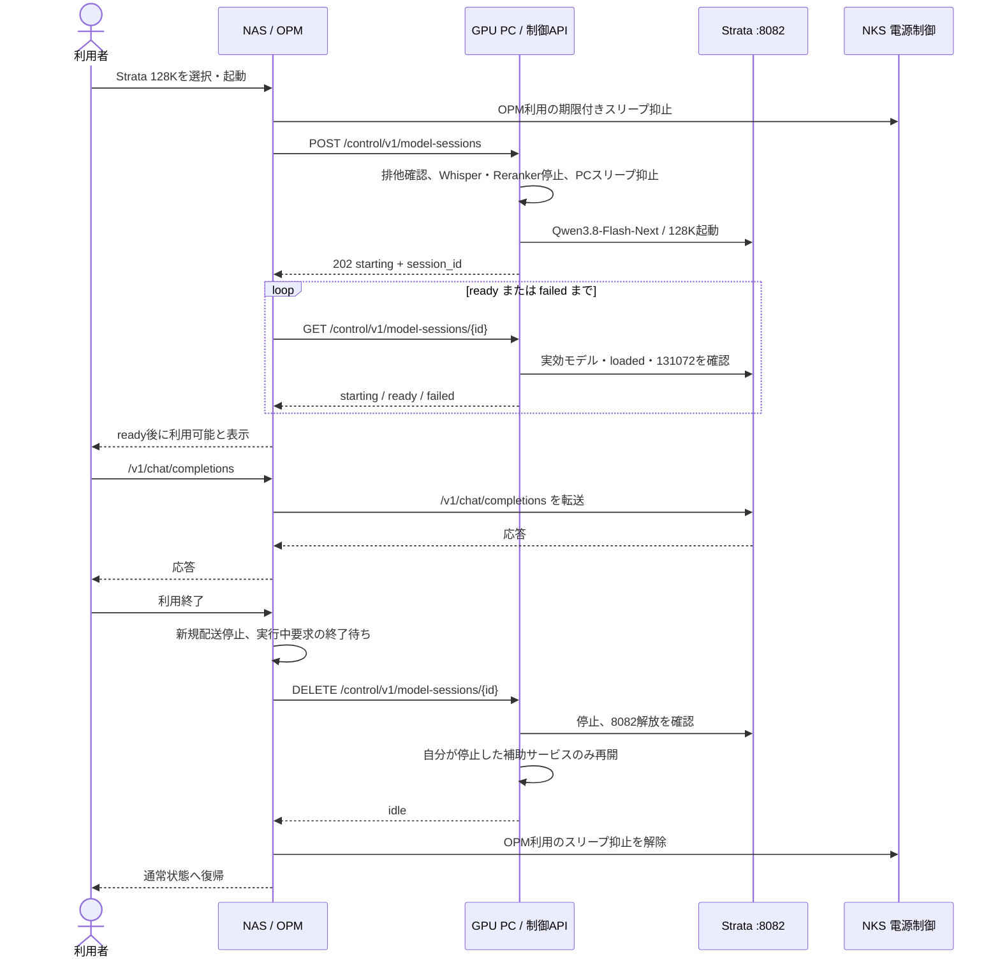

# OPM から Strata 128K を起動・利用・解放する連携仕様案

2026-10-07: PC 側の `POST /control/v1/model-sessions` は `model` に `strata128k`（Vision なし）または `strata128kvision`（Vision あり）を受け付ける。Vision ありは専用起動スクリプトを使用し、`/v1/status` の `vision.enabled=true` と `vision.available=true` を確認してから `ready` にする。推論先はどちらも 8082、モデル ID は `qwen3.8-flash-next-iq2_xs`。NKS 側の外部セッション用スリープ抑止は引き続き未実装。

2026-10-08: PC 制御ポート 11502 の `GET /v1/models` は、停止中も `strata128k` と `strata128kvision` を OpenAI 形式の `object: "list"` / `data` で返す。各項目の `vision`、`session_state`、`ready` は選択・表示用。`id` はセッション起動 API に渡す値であり、推論時の Strata モデル ID は `qwen3.8-flash-next-iq2_xs`。推論は 8082 に送る。

2026-10-08 追記: `qwen38`（Qwen3.8-27B）と `qwen3coder`（Qwen3-Coder-30B）も同じセッション API と `/v1/models` から選べる。外部推論入口は全モデル共通で PC の `:8082/v1/chat/completions`。OPM が 11502 でセッションを開始し `ready=true` を確認してから 8082 に要求を送る。8082 のゲートウェイは要求の `model` を起動中の構成と照合し、内部の Strata `127.0.0.1:18082`、Qwen3.8 `127.0.0.1:30000`、Qwen3-Coder `127.0.0.1:30001` に転送する。`model` はカタログ ID または実効モデル ID を指定できる。異なるモデルは 409、未起動は 503。内部ポートは GPU PC 内部で使い、外部クライアントは 8082 を使う。

8082 は `/control/v1/model-sessions` も 11502 の制御 API へ転送するため、外部クライアントは一覧・起動・状態確認・終了・推論をすべて 8082 で実行できる。11502 の直接アクセスは既存クライアントとの互換性のため残す。

2026-10-08 照合条件: Strata の二構成は `inference_model` と `context_window` が同じため、OPM はセッション GET の `vision.enabled` をカタログの `vision` と必ず比較する。Qwen3.8-27B と Qwen3-Coder は起動時コンテキストを 65536 に固定し、PC は SGLang `/server_info` の `context_length=65536` と `/v1/models` の実効モデル名を確認してからセッションを `ready` にする。OPM はセッション GET の `context.max_positions` とカタログの `context_window` も比較する。

Qwen の ready 判定は `/server_info` の `max_total_num_tokens >= context_window` も要求する。2026-10-08 の Qwen3.8 実機検証では `context_length=65536`、`max_total_num_tokens=117921`、セッション GET `ready=true`・`context.max_positions=65536`、8082 経由の短い推論応答を確認し、検証セッションを DELETE して `idle` に戻した。Qwen3-Coder の実起動は未検証。

後日タスク（未着手）: Strata Vision なし/あり、Qwen3.8-27B、Qwen3-Coder-30B の各構成について、指定可能なコンテキストサイズを段階的に実機計測する。起動可否、実効コンテキスト、KV 容量・入力上限、境界付近の推論成否、GPU/メモリ使用量を記録し、安定最大値を起動設定とカタログ・ready 判定に反映する。

作成: 2026-10-04
状態: GPU PC 側の制御 API を実装中。OPM・NKS 連携、実機検証は未完了

### 2026-10-05 変更仕様（OPM 側への連絡事項）

1. `GET /control/v1/model-sessions/availability` を追加。HTTP 200 で `available`、`code`、`message`、`http_status`、`retry_after_s`、`checked_at` を返す。POST と同じ事前判定だが予約ではない。
2. 存在しないセッション ID の GET/PUT/DELETE は `404 session_not_found`。経路外の `404 not_found` と区別する。
3. 補助タスク状態を確認できない場合は `503 state_unavailable`。JSON・入力不正は `400 bad_request`。
4. OPM は利用可否 GET を画面表示に使い、POST の応答を最終判断とする。`available=true` は GPU メモリ解放や Strata ready の保証ではない。
5. 実機反映後、作業宣言中の GET は `200 {"available":false,"code":"human_work_hold","http_status":409,...}`、未知 ID は `404 session_not_found`、不正 JSON は `400 bad_request` を確認。Strata は起動していない。

### 実装メモ（2026-10-04）

- GPU PC 側に `model-sessions.js` と別ポートの制御 API を追加。オーナーの 2026-10-05 指示により、`11502` は全接続元に公開。監視タスク再起動後、`0.0.0.0:11502` の待ち受けと、LAN アドレス `192.168.0.196` 経由の GET 404 / 不正モデル POST 400 を確認。Strata の起動要求は送っていない。
- `scripts/Configure-ModelControl-TailscaleFirewall.ps1` の実効規則は TCP 11502 / Inbound Allow / RemoteAddress Any / Profile Any。
- NAS コンテナは tailnet に出られないため、`scripts/Configure-Strata-LanFirewall.ps1` を追加・実行。実効規則は TCP 8082 / Inbound Allow / RemoteAddress `192.168.0.198`。Strata は現在起動していない。
- NKS の専用スリープ抑止ゲートはオーナー指示で外した。PC 内のスリープガードは有効になるが、NAS からの即時 sleep 指令を防ぐ保証は未実装。既存の人用作業宣言・GPU 競合確認は維持。
- この PC 実装では起動前に既存 SGLang、8082、ローカル推論、人の作業宣言、補助タスク状態を確認する。Whisper・Reranker を停止後、GPU 空きメモリ 22000 MiB 以上を要求し、Strata の実効状態で ready を判定する。
- 残件: NAS コンテナから 11502/8082 の到達確認、Strata の実起動・停止検証（オーナー処理終了後）、NKS の専用抑止 API、OPM の UI・配送・TTL 更新・終了時の in-flight 排水、PC/OPM 再起動と通信断の実機検証。

## 目的と責務

NAS 上の OPM（`C:\Apps\nas-knowledge-stack\UnifiedOllamaProxyMonitor`）の UI でモデルを選び、GPU PC でロードが完了してから OPM 経由で推論する。利用終了時は OPM が新規配送を止め、GPU PC がモデルを停止して、セッション開始前に動いていた補助サービスを再開する。

| 担当 | 責務 |
| --- | --- |
| OPM | UI、モデルカタログ、推論の単一入口、待ち行列、GPU PC への起動・解放要求、実行中要求の終了待ち |
| OllamaPCMonitor（GPU PC） | GPU 排他、Strata 起動・ready 判定、期限付きセッション、Whisper・Reranker の停止と復帰、Windows 自動スリープ抑止 |
| NKS 電源制御 | OPM セッション中に GPU PC を自動スリープさせない。人の作業宣言とは別に扱う |

推論クライアントは OPM にだけ接続し、Strata の `8082` を直接利用しない。OPM サーバーから GPU PC への制御と推論は NAS の LAN 経路を使う。

## シーケンス



## 現行実装との境界

- OllamaPCMonitor の `/monitor/api/work-hold` と `/monitor/api/sglang-services` は `127.0.0.1:11501` に限定され、Host と Origin も localhost に限定している。NAS の OPM がそのまま呼ぶことはできない。
- 既存の `work_hold` は「PC 利用者のローカル作業」として NKS から OPM に伝わり、5090 宛ての外部ルーティングを止める。OPM のモデル利用セッションに流用してはならない。
- Strata は `0.0.0.0:8082` で待ち受け、Windows ファイアウォールは Tailscale インターフェース上の `100.64.0.0/10` からの受信に限定済み。これは推論 API であり、モデルの起動 API ではない。
- OPM の health poller は `protocol=openai` の `/v1/models` を読める。一方、現行のモデル配送候補は `protocol=ollama` のみを採用し、モデル ID に Ollama 用の `:latest` を補う。Strata への OpenAI 互換要求を配送するには OPM 側の変更が必要。

### Image input status (2026-10-04)

The default Strata text-only configuration still reports image input unavailable. A separate vision-enabled 128K configuration now runs and has returned the exact text `VISION 42` from a PNG through OpenAI-compatible `image_url`. The vision-enabled 512K experimental configuration passed the same check. See [vision benchmark](strata-vision-bench-2026-10-04.md). OPM should derive `capabilities.image_input` from the active session (`/v1/status` vision enabled and available), not from the model name. Video frames remain unverified.

## GPU PC 側に追加する契約

### 接続

制御 API は推論 API と分離し、`11502` で待ち受ける。2026-10-05 のオーナー指示により、初版は認証なし・全接続元から利用可能とする。OPM は LAN アドレス `192.168.0.196:11502` を使う。既存の localhost 専用 `11501` は公開しない。Strata の `8082` は NAS の LAN アドレス `192.168.0.198` から受信できる。

### エンドポイント

| Method / path | 入力 | 応答 |
| --- | --- | --- |
| `GET /control/v1/model-sessions/availability` | なし | `200`。後述の事前判定を返す。副作用なし |
| `POST /control/v1/model-sessions` | `{"model":"strata128k","ttl_seconds":1800,"request_id":"<idempotency-id>"}` | `202 {"session_id":"...","state":"starting","expires_at":"..."}`。同じ `request_id` は同じセッションを返す |
| `GET /control/v1/model-sessions/{id}` | なし | `state`, `model`, `expires_at`, `ready`, `error`、実効モデル ID とコンテキスト |
| `PUT /control/v1/model-sessions/{id}` | `{"ttl_seconds":1800}` | 延長後の `expires_at`。所有者が同じセッションだけ延長可 |
| `DELETE /control/v1/model-sessions/{id}` | なし | 停止・復帰完了後 `200 {"state":"idle"}`。再送は同じ結果 |

### 利用可否の事前判定（追加仕様 2026-10-05）

`GET /control/v1/model-sessions/availability` は POST と同じ競合・電源・補助タスク確認を実行する。`200` の本文は次の形式とする。

```json
{"available":false,"code":"human_work_hold","message":"Local work declaration is active","http_status":409,"retry_after_s":30,"checked_at":"2026-10-05T00:00:00.000Z"}
```

利用可能なら `available=true`、`code`・`message`・`http_status`・`retry_after_s` は `null`。この確認は予約ではない。GET の直後に状態が変わり得るため、POST は必ず同じ判定を再実行し、競合時は同じ `code` で拒否する。起動後にしか確定しない GPU メモリ解放・Strata ready までは保証しない。OPM は GET を UI の事前表示に使い、POST の応答を最終判定とする。

状態は `starting → ready → stopping → idle`、失敗時は `failed → stopping → idle`。`ready` は TCP 接続や `/health` の HTTP 200 だけで判定しない。Strata の `/v1/status` で `loaded=true`、`model=qwen3.8-flash-next-iq2_xs`、`context.max_positions=131072` を確認する。起動待ち上限は 180 秒を目安とし、超過時は `failed` として後始末する。

既存の GPU PC 利用者が大型モデルを使っている、手動作業宣言がある、GPU 解放を確認できない、または NKS の電源方針が許さない場合は `409` と理由コードを返す。既存の利用を強制停止しない。TTL が切れた場合は PC 側でも自動停止・復帰する。管理状態は再起動後も照合できるよう永続化する。

補助サービスの復帰対象は、このセッションが実際に停止したタスクだけを記録する。停止前から止まっていたタスクや、セッション中に人が変更した状態を一律に「起動」に戻さない。モデル停止では管理対象 PID の消滅と `8082` の解放を確認する。

### エラー応答

`{"code":"gpu_busy|human_work_hold|policy_blocked|start_failed|ready_timeout|session_conflict","message":"...","retry_after_s":30}` のように、UI が待機・再試行・手動対応を分けられる符丁を返す。`409` は競合、`503` は一時的な準備不可、`500` は制御失敗を示す。

| HTTP | `code` | 用途 |
| --- | --- | --- |
| 400 | `bad_request` | JSON または入力値が不正 |
| 404 | `not_found` | 制御 API の経路外 |
| 404 | `session_not_found` | 指定 ID のセッションが存在しない |
| 409 | `human_work_hold` / `gpu_busy` / `session_conflict` | 人の作業宣言、GPU 使用中、既存セッションとの競合 |
| 503 | `policy_blocked` / `state_unavailable` | NKS 電源状態または補助タスク状態を確認できない |
| 500 | `stop_failed` / `control_failed` | 停止・制御処理の失敗 |

非同期の起動失敗は POST の後に `GET /control/v1/model-sessions/{id}` の `state=failed` と `error_code=start_failed|ready_timeout` で通知する。`retry_after_s` は 409/503 の HTTP エラーに付ける。利用可否 GET は常に HTTP 200 とし、同等の HTTP 状態を `http_status` に入れる。

## OPM 側へ依頼する仕様

1. 停止中でも選べる固定カタログ項目「Qwen3.8-Flash-Next / Strata 128K」を UI に追加する。現在の `/v1/models` は稼働中の health 情報から作られるため、停止中モデルの起動ボタンの根拠に使わない。
2. UI 操作は OPM バックエンドへ送る。バックエンドが PC 制御 API にセッション作成を要求し、2 秒程度の間隔で `ready` または `failed` まで問い合わせる。`starting` 中は推論を受け付けず、進捗と失敗理由を表示する。現行構成では画像入力を無効と表示する。
3. `ready` の間だけ `qwen3.8-flash-next-iq2_xs` を `protocol=openai` の OPM 配送候補にする。初版の対象は `/v1/chat/completions`。モデル ID に `:latest` を付けず、リクエスト本文の ID を Strata が受け付ける形で維持する。`/api/chat` など Ollama 固有 API は別途変換が必要で、初版の対象外とする。
4. OPM の scheduler と流量記録を通して `http://100.74.75.123:8082/v1/chat/completions` に転送する。PC 側 API の ready と OPM 側の配送可能状態を分けて記録する。
5. 利用中はセッション TTL を延長する。UI の「終了」では新規配送を止め、実行中の生成が終わるのを待ってから DELETE する。OPM 再起動時はセッション ID で再照合し、孤児セッションを期限切れに任せず可能なら解放する。
6. モデル配送の有効化はセッション状態から導き、既存 upstream の恒久 `enabled` や人が設定した `auto_wake_enabled` を書き換えない。UI からの停止と TTL 失効は同じ後始末を通す。

## NKS / 電源制御への追加契約

OPM が GPU PC を使う間は、NKS 側にも期限付きの「外部 LLM セッション中」を渡す必要がある。この状態は PC の自動スリープを防ぐが、OPM の当該モデルへの配送を妨げない。既存の人用 `work_hold` / `route_block` とは別の状態にし、OPM 停止・通信断でも TTL で解除する。OPM 側の `auto_sleep_hold_until` だけで NKS の即時 sleep 指令も防げるかは別途確認が必要で、確認前は単独の保証にしない。

## 受け入れ条件

- NAS の OPM コンテナから PC の LAN アドレス `192.168.0.196:11502` と `192.168.0.196:8082` に到達できる。制御口はオーナー指示により全接続元へ公開する。
- PC で人の作業宣言または別の大型モデルが稼働中なら、OPM 起動要求は `409` で拒否され、既存の状態は変わらない。
- 起動が成功すると Strata の実効状態が `loaded=true` / `131072` になり、その後に限り OPM の `/v1/chat/completions` が Strata に届く。
- OPM の画面から終了した場合、実行中の要求が終わってから Strata を停止し、セッションが止めた補助サービスだけ復帰する。
- OPM 障害・PC 再起動・起動失敗・TTL 失効の各場合に、セッションが残留せず、電源抑止と GPU 排他が整合する。
